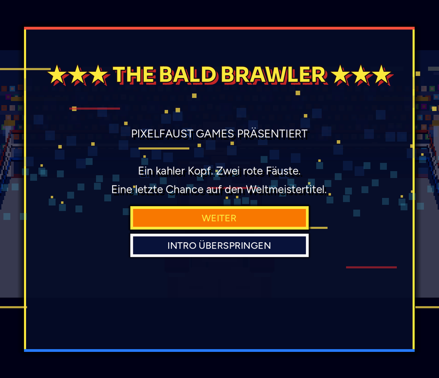
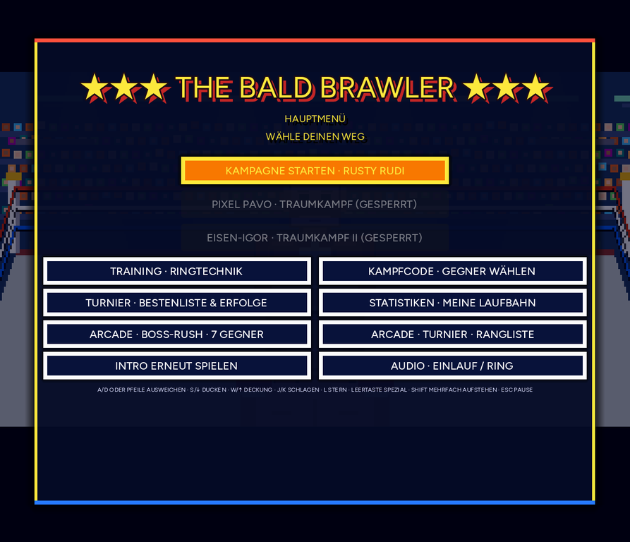

# The Bald Brawler

## Öffentlicher Browser-Client

[**The Bald Brawler jetzt spielen**](https://schattenregent.github.io/the-bald-brawler-pages/)

Ein deutscher NES-inspirierter Arcade-Boxkampf im Browser: drei Runden, 10-Count, Coach Konrad, Referee, Trainingsmodus und World Circuit.

## Schnellstart

1. Öffne den öffentlichen Link und warte, bis das Intro geladen ist.
2. Wähle **„INTRO ÜBERSPRINGEN“** oder spiele das Intro mit **„WEITER“**.
3. Starte im Hauptmenü **„KAMPAGNE STARTEN – RUSTY RUDI“**.
4. Bestätige die Vorkampfkarte und beginne die Runde.

## Steuerung

| Aktion | Tastatur |
|---|---|
| Ausweichen | `A` / `D` oder Pfeiltasten |
| Ducken | `S` / Pfeil nach unten |
| Deckung | `W` / Pfeil nach oben |
| Jab | `J` |
| Hook | `K` |
| Sternangriff | `L` |
| Spezialangriff | Leertaste |
| Nach KO aufstehen | `Shift` mehrfach drücken |
| Pause | `Esc` |

## Spielziel

Lies die Tells des Gegners, weiche im richtigen Moment aus und kontere gezielt. Treffer laden Sterne auf; saubere Konter und Spezialangriffe erzeugen zusätzliche Treffer- und Schadenseffekte. Ein Kampf wird über die Runden, Knockdowns und den Referee-Count entschieden.

## Spielmodi

- Kampagne durch Minor, Major und World Circuit
- Trainingslabor für Ringtechnik
- Kampfcodes zur Gegnerauswahl
- Arcade Boss-Rush und Ranglisten
- Statistiken, Erfolge und Audio-Einstellungen

## Technischer Hinweis

Die großen Godot-Binärdateien werden als inhaltsversionierte Dateien veröffentlicht. Dadurch können wiederkehrende Spieler unveränderte WASM-/PCK-Versionen aus dem Browsercache nutzen, während neue Releases automatisch neue URLs erhalten.
## Screenshots

### Intro

### Hauptmenü

## Kurzer Trailertext

> Ein kahler Kopf. Zwei rote Fäuste. Eine letzte Chance auf den Weltmeistertitel.
> Lies jeden Schlagansatz, weiche im richtigen Moment aus und schicke die Gegner im klassischen 8-Bit-Arcade-Stil auf die Bretter.

## Lade- und Cache-Optimierung

- WASM und PCK werden unter Inhalts-Hashes ausgeliefert: Änderungen erzeugen automatisch neue URLs.
- Preload-Tags beginnen den Download der beiden großen Dateien bereits während des HTML-Ladens.
- `sw.js` verwendet für versionierte WASM-/PCK-Dateien eine Cache-First-Strategie. Wiederkehrende Spieler laden unveränderte Releases dadurch lokal.
- Die HTML-Datei bleibt kurzlebig revalidierbar; die versionierten Binärdateien können sicher wiederverwendet werden.

GitHub Pages erlaubt keine projektspezifischen `Cache-Control: immutable`-Header. Die Kombination aus Hash-Dateinamen, Preload und Service Worker ist deshalb die sichere Optimierung innerhalb der Plattformgrenzen.

